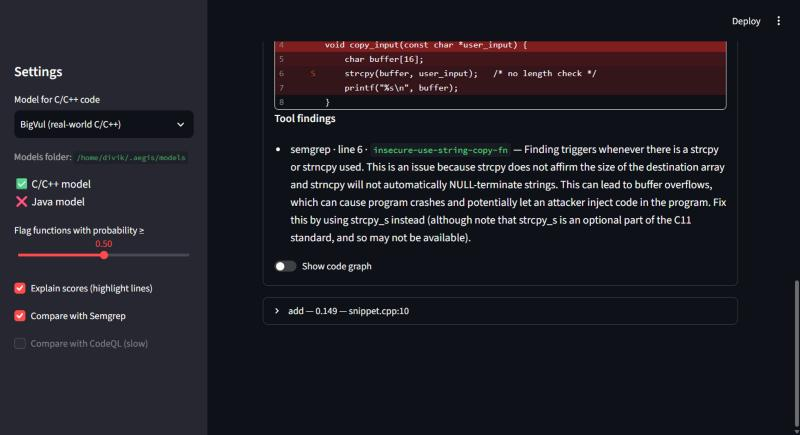
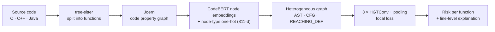
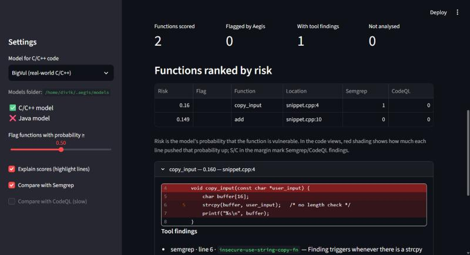
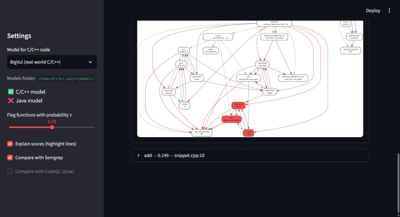

<div align="center">

# 🛡️ Aegis

**Vulnerability detection for C/C++ and Java with heterogeneous graph neural networks on code property graphs**

[](https://github.com/Hikunokyojin/aegis/actions/workflows/ci.yml)


</div>

Rule-based scanners find the bugs someone has already written a rule for. Aegis learns what vulnerable code
*looks like*: every function becomes a **code property graph** that keeps syntax, control flow and data flow as
three separate kinds of edges, every node is described by a code language model, and a **heterogeneous graph
transformer** learns which relational patterns signal a vulnerability, including ones no rule describes.

<p align="center">
  
</p>

## Highlights

- **Graph-native.** Syntax (AST), control-flow (CFG) and data-flow (reaching definitions) edges stay distinct, and the model learns separate attention for each.
- **Two languages, one pipeline.** The same commands handle C/C++ and Java.
- **Leak-free by construction.** Data is split by project, file or test case so near-duplicate code never lands in both training and test data. A test proves deliberately leaked splits are rejected, and Juliet's label-revealing names are neutralised.
- **Benchmarked fairly.** Aegis, [Semgrep](https://semgrep.dev) and [CodeQL](https://codeql.github.com) are scored on exactly the same held-out functions with PR-AUC and F1.
- **Explainable.** Each prediction is traced back to the source lines that drove it (gradient × input attribution).
- **Usable.** A web app scans pasted code, uploaded projects or GitHub repositories. A CLI scans files and folders; both share one scoring engine.
- **Safe to host.** Uploaded code is deleted after each scan; scans are size-, time- and rate-limited; model files load without executing code and are checked against SHA-256 checksums; dependencies are audited in CI.
- **Free to reproduce.** The full pipeline runs on a free Kaggle GPU, resumes after interruptions, and is covered by 100+ tests.

## How it works



| Stage | Module | What happens |
|---|---|---|
| Parse | `aegis.parsing` | Grammar-based parsing; functions extracted from namespaces, classes and `#ifdef` blocks |
| Graph | `aegis.graphs` | Joern builds the CPG; a many-function export is split back into one graph per function |
| Embed | `aegis.embeddings` | `microsoft/codebert-base` [CLS] embedding for every node's code |
| Data | `aegis.dataset` | BigVul and Juliet loaders; leak-free, class-balanced group splitting |
| Model | `aegis.model` | `AegisHeteroGNN`: 3 HGTConv layers, residual + LayerNorm, mean pooling; focal loss |
| Train | `aegis.training` | Resumable training; best checkpoint by validation PR-AUC |
| Evaluate | `aegis.evaluation` | Semgrep and CodeQL on the same functions; PR-AUC, F1, precision, recall |
| Use | `aegis.scanning`, `aegis.ui` | One scoring engine behind the command-line scanner and the web app |

## Results

Held-out test functions, 2,000-function sample per dataset, 30 epochs on a Kaggle T4, **five training seeds** (mean ± std, 95% CI). All three tools are scored on the same functions; p is a paired bootstrap test of Aegis against each baseline.

| Dataset | Aegis PR-AUC | Semgrep PR-AUC | CodeQL PR-AUC | p |
|---|:---:|:---:|:---:|:---:|
| BigVul (real-world C/C++) | **0.139 ± 0.014** (0.121–0.156) | 0.056 | 0.056 | 0.029 |
| Juliet Java | **0.421 ± 0.042** (0.369–0.473) | 0.304 | 0.296 | ≤ 0.002 |
| Juliet C/C++ | **0.780 ± 0.044** (0.725–0.835) | 0.362 | 0.367 | 0.001 |

Aegis ranks vulnerable functions above safe ones better than both rule-based baselines on every dataset. A tool that flags nothing scores PR-AUC equal to the share of vulnerable functions in the test set.

**Robustness.** Renaming variables or inserting dead code (behaviour unchanged) flipped 14–88% of the plain models' verdicts; models trained on such variants flip 0.3–11%. A planted 5% trigger backdoor never hid a detected bug, and a spectral-signature scan found 23% of poisoned Juliet C/C++ samples (random: 7.5%).

**Read these numbers with care:**
- Real-world code (BigVul) remains hard, and that model overfits a 2,000-function sample.
- Juliet is synthetic and repetitive, so its scores are optimistic.
- The baselines see single functions without the rest of the program, which limits their inter-procedural analysis.
- Line explanations hit a line changed by the real BigVul fix 31% of the time (top 3 lines) against 27% for random lines, so treat them as hints.

## Quick start

**Requirements:** Python 3.10+, Java 21 and [Joern v4.0.597](https://github.com/joernio/joern/releases/tag/v4.0.597) on your `PATH`. Semgrep and the CodeQL CLI are needed only for benchmarking.

```bash
git clone https://github.com/Hikunokyojin/aegis.git
cd aegis
pip install -e ".[dev,ui]"
pytest -q
```

### Web app

```bash
aegis-ui        # opens http://localhost:8501
```

Paste code, upload files or a `.zip`, or give a public GitHub link. Every function is ranked by risk, with the lines behind each score highlighted, Semgrep findings alongside, and an interactive view of the function's graph. Trained models are read from `~/.aegis/models/` (`bigvul.pt`, `juliet-cpp.pt`, `juliet-java.pt`) or from `$AEGIS_MODELS_DIR`.

<p align="center">
  
  
</p>

### Command line

```bash
# 1. Build one graph per function, split leak-free into train / val / test
aegis-build-training-graphs --dataset juliet-java --input path/to/juliet-java --output-dir data/juliet-java --sample-size 2000

# 2. Train (resumable; keeps the best model by validation PR-AUC)
aegis-train --data-dir data/juliet-java --run-dir runs/juliet-java --epochs 30

# 3. Benchmark against Semgrep and CodeQL on the same held-out functions
aegis-evaluate --data-dir data/juliet-java --run-dir runs/juliet-java

# 4. Rank the functions in any C/C++/Java code
aegis-scan --checkpoint runs/juliet-java/best.pt path/to/project
```

`--dataset` accepts `bigvul` (the [BigVul CSV](https://github.com/ZeoVan/MSR_20_Code_vulnerability_CSV_Dataset)), `juliet-java` or `juliet-cpp` (an extracted [NIST Juliet v1.3](https://samate.nist.gov/SARD/test-suites) archive).

### Languages

C, C++ and Java are scored by trained models. Python, JavaScript and Go files are parsed into functions, turned into code property graphs by Joern and checked by Semgrep, and listed as "no trained model" rather than given a score the model was never trained for. Training a model for them needs a labelled dataset in that language; the pipeline is otherwise the same.

### Responsible disclosure

When a scanned public GitHub repository has flagged functions, the web app explains how to report a confirmed issue privately: it shows the project's `SECURITY.md` if it has one and links to GitHub's private vulnerability report form, and asks you to verify by hand first and not to open a public issue.

### Hosting

`deploy/huggingface/Dockerfile` runs the web app on a free Hugging Face Space (CPU basic). Optional "Sign in with Hugging Face" for repository scans is configured in `.streamlit/secrets.toml` (see `.streamlit/secrets.example.toml`). Each session's scans are listed in the sidebar and can be downloaded as JSON; nothing is stored on the server.

### Scanning at scale

```bash
aegis-scan --checkpoint runs/bigvul/best.pt --cache-dir ~/.aegis/cache --workers 4 path/to/repo  # re-scans only edited functions
aegis-scan --checkpoint runs/bigvul/best.pt --quantize path/to/repo                               # 8-bit models, ~1.7x faster on CPU
aegis-build-training-graphs ... --workers 4                                                        # parallel Joern
aegis-serve --port 8000                                                                            # HTTP service with a job queue
```

Every scan also builds a call graph over the scanned code. A function that calls a risky function inherits part of its risk (decaying with each call, up to three calls deep), and the report shows the call chain, so flaws that span functions are not hidden by scoring each function alone.

The service takes `POST /scans` with `{"files": {"path.c": "<code>"}}` and returns a job id; `GET /scans/{id}` returns the result. Jobs run one at a time from a capped queue, and submitted code is deleted when its job ends.

### Studies

```bash
aegis-study seeds     --data-dir data/bigvul --runs runs/s0 runs/s1 runs/s2   # mean ± 95% CI, paired test vs baselines
aegis-study cross     --checkpoint runs/juliet-cpp/best.pt --data-dir data/bigvul  # synthetic → real transfer
aegis-study cwe       --data-dir data/juliet-cpp --run-dir runs/juliet-cpp         # results per vulnerability type
aegis-study calibrate --data-dir data/bigvul --run-dir runs/bigvul   # temperature scaling + "uncertain" margin
aegis-study explain   --data-dir data/bigvul --run-dir runs/bigvul   # do highlighted lines hit the real fix?
aegis-study noise     --data-dir data/bigvul --run-dir runs/bigvul   # conflicting duplicates, suspicious labels
```

Model security:

```bash
aegis-study robustness    --data-dir data/bigvul --run-dir runs/bigvul --limit 300  # renamed variables / dead code: does the verdict flip?
aegis-study augment       --data-dir data/bigvul   # transformed training copies; train with --extra-train-dir to harden
aegis-study poison        --data-dir data/bigvul --rate 0.05   # plant a backdoor to test defences
aegis-study detect-poison --data-dir data/bigvul --run-dir runs/bigvul_poisoned   # spectral-signature scan
```

`aegis-build-training-graphs --split-mode time` trains on older CVEs and tests on newer ones (a zero-day setting), and `--compact` halves graph storage for full-dataset builds. `aegis-train --seed` fixes the seed, and `--exclude-ids` drops audited noisy labels. Training streams graphs from disk, so the full datasets fit in memory. A calibrated model marks borderline functions as *uncertain* in the scanner and web app.

### On a free GPU

[`notebooks/kaggle_pipeline.ipynb`](notebooks/kaggle_pipeline.ipynb) runs the whole pipeline (install, build graphs, train, benchmark, scan) on Kaggle. Choose the dataset in the first cell and run all cells.

## Project layout

```
src/aegis/
├── parsing/      grammar-based parsing and function extraction (C/C++, Java)
├── dataset/      BigVul and Juliet loaders, leak-free splitting
├── embeddings/   CodeBERT node embeddings
├── graphs/       Joern GraphML → PyTorch Geometric HeteroData
├── pipeline/     batch dataset → graph building
├── model/        heterogeneous graph transformer and focal loss
├── training/     resumable training loop
├── evaluation/   Semgrep / CodeQL baselines and benchmark
├── scanning/     scoring engine, graph cache, call graph, command-line scanner
├── service/      HTTP scanning service
└── ui/           web app (Streamlit) and its analysis logic
notebooks/        end-to-end Kaggle pipeline
tests/            pytest suite with C++/Java fixtures
```

## Acknowledgements

Aegis builds on [Joern](https://github.com/joernio/joern) and the code property graph (Yamaguchi et al., IEEE S&P 2014), the Heterogeneous Graph Transformer (Hu et al., WWW 2020), [CodeBERT](https://huggingface.co/microsoft/codebert-base), the [BigVul](https://github.com/ZeoVan/MSR_20_Code_vulnerability_CSV_Dataset) dataset and the [NIST Juliet Test Suite](https://samate.nist.gov/SARD/test-suites).

## License

Copyright © 2026 Divik Bhaskar. All rights reserved. See [LICENSE](LICENSE).
