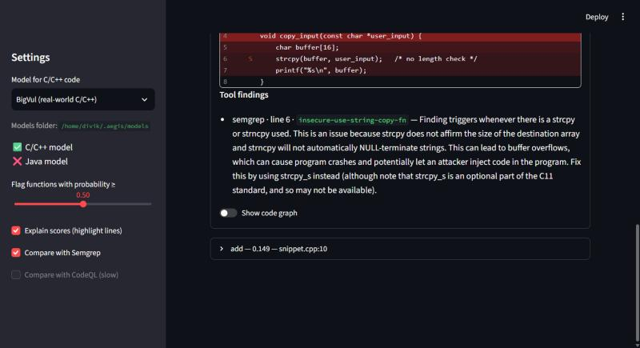
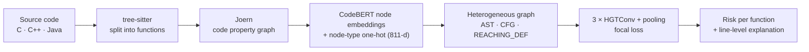
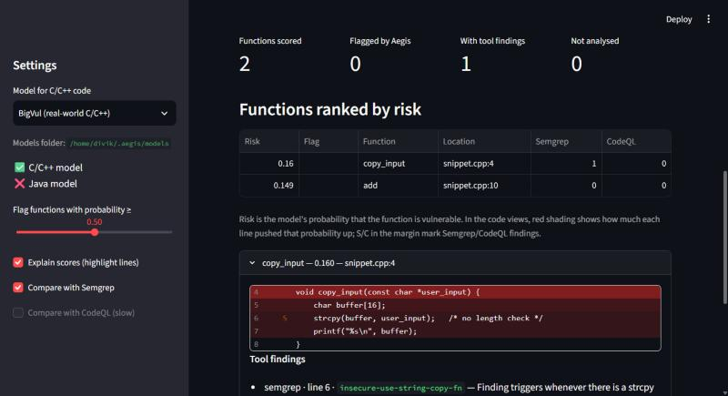
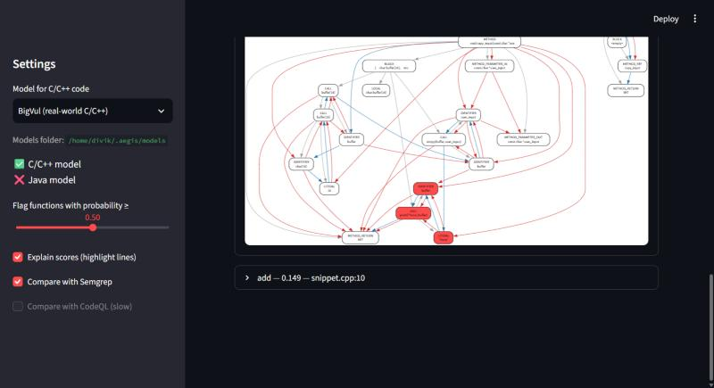

<div align="center">

# 🛡️ Aegis

**Vulnerability detection for C/C++ and Java with heterogeneous graph neural networks on code property graphs**

[](https://github.com/Hikunokyojin/aegis/actions/workflows/ci.yml)


</div>

Rule-based scanners find the bugs someone has already written a rule for. Aegis learns what vulnerable code
*looks like*: every function becomes a **code property graph** that keeps syntax, control flow and data flow as
three separate kinds of edges, every node is described by a code language model, and a **heterogeneous graph
transformer** learns which relational patterns signal a vulnerability, including ones no rule describes.

<p align="center">
  
</p>

## Highlights

- **Graph-native.** Syntax (AST), control-flow (CFG) and data-flow (reaching definitions) edges stay distinct, and the model learns separate attention for each.
- **Two languages, one pipeline.** The same commands handle C/C++ and Java.
- **Leak-free by construction.** Data is split by project, file or test case so near-duplicate code never lands in both training and test data. A test proves deliberately leaked splits are rejected, and Juliet's label-revealing names are neutralised.
- **Benchmarked fairly.** Aegis, [Semgrep](https://semgrep.dev) and [CodeQL](https://codeql.github.com) are scored on exactly the same held-out functions with PR-AUC and F1.
- **Explainable.** Each prediction is traced back to the source lines that drove it (gradient × input attribution).
- **Usable.** A web app scans pasted code, uploaded projects or GitHub repositories. A CLI scans files and folders.
- **Free to reproduce.** The full pipeline runs on a free Kaggle GPU, resumes after interruptions, and is covered by 100+ tests.

## How it works



| Stage | Module | What happens |
|---|---|---|
| Parse | `aegis.parsing` | Grammar-based parsing; functions extracted from namespaces, classes and `#ifdef` blocks |
| Graph | `aegis.graphs` | Joern builds the CPG; a many-function export is split back into one graph per function |
| Embed | `aegis.embeddings` | `microsoft/codebert-base` [CLS] embedding for every node's code |
| Data | `aegis.dataset` | BigVul and Juliet loaders; leak-free, class-balanced group splitting |
| Model | `aegis.model` | `AegisHeteroGNN`: 3 HGTConv layers, residual + LayerNorm, mean pooling; focal loss |
| Train | `aegis.training` | Resumable training; best checkpoint by validation PR-AUC |
| Evaluate | `aegis.evaluation` | Semgrep and CodeQL on the same functions; PR-AUC, F1, precision, recall |
| Use | `aegis.scanning`, `aegis.ui` | Command-line scanner and web app |

## Results

Held-out test functions, 2,000-function sample per dataset, trained for 30 epochs on a Kaggle T4. All three tools are scored on the same functions.

| Dataset | Aegis PR-AUC | Semgrep PR-AUC | CodeQL PR-AUC | Aegis F1 |
|---|:---:|:---:|:---:|:---:|
| BigVul (real-world C/C++) | **0.145** | 0.056 | 0.056 | 0.095 |
| Juliet Java | **0.494** | 0.304 | 0.296 | 0.500 |
| Juliet C/C++ | **0.856** | 0.362 | 0.367 | 0.777 |

Aegis ranks vulnerable functions above safe ones better than both rule-based baselines on every dataset. A tool that flags nothing scores PR-AUC equal to the share of vulnerable functions in the test set.

**Read these numbers with care:**
- Real-world code (BigVul) remains hard, and that model overfits a 2,000-function sample.
- Juliet is synthetic and repetitive, so its scores are optimistic.
- The baselines see single functions without the rest of the program, which limits their inter-procedural analysis.

## Quick start

**Requirements:** Python 3.10+, Java 21 and [Joern v4.0.597](https://github.com/joernio/joern/releases/tag/v4.0.597) on your `PATH`. Semgrep and the CodeQL CLI are needed only for benchmarking.

```bash
git clone https://github.com/Hikunokyojin/aegis.git
cd aegis
pip install -e ".[dev,ui]"
pytest -q
```

### Web app

```bash
aegis-ui        # opens http://localhost:8501
```

Paste code, upload files or a `.zip`, or give a public GitHub link. Every function is ranked by risk, with the lines behind each score highlighted, Semgrep/CodeQL findings alongside, and an interactive view of the function's graph. Trained models are read from `~/.aegis/models/` (`bigvul.pt`, `juliet-cpp.pt`, `juliet-java.pt`) or from `$AEGIS_MODELS_DIR`.

<p align="center">
  
  
</p>

### Command line

```bash
# 1. Build one graph per function, split leak-free into train / val / test
aegis-build-training-graphs --dataset juliet-java --input path/to/juliet-java --output-dir data/juliet-java --sample-size 2000

# 2. Train (resumable; keeps the best model by validation PR-AUC)
aegis-train --data-dir data/juliet-java --run-dir runs/juliet-java --epochs 30

# 3. Benchmark against Semgrep and CodeQL on the same held-out functions
aegis-evaluate --data-dir data/juliet-java --run-dir runs/juliet-java

# 4. Rank the functions in any C/C++/Java code
aegis-scan --checkpoint runs/juliet-java/best.pt path/to/project
```

`--dataset` accepts `bigvul` (the [BigVul CSV](https://github.com/ZeoVan/MSR_20_Code_vulnerability_CSV_Dataset)), `juliet-java` or `juliet-cpp` (an extracted [NIST Juliet v1.3](https://samate.nist.gov/SARD/test-suites) archive).

### On a free GPU

[`notebooks/kaggle_pipeline.ipynb`](notebooks/kaggle_pipeline.ipynb) runs the whole pipeline (install, build graphs, train, benchmark, scan) on Kaggle. Choose the dataset in the first cell and run all cells.

## Project layout

```
src/aegis/
├── parsing/      grammar-based parsing and function extraction (C/C++, Java)
├── dataflow/     Joern CPGQL taint-flow queries
├── dataset/      BigVul and Juliet loaders, leak-free splitting
├── embeddings/   CodeBERT node embeddings
├── graphs/       Joern GraphML → PyTorch Geometric HeteroData
├── pipeline/     batch dataset → graph building
├── model/        heterogeneous graph transformer and focal loss
├── training/     resumable training loop
├── evaluation/   Semgrep / CodeQL baselines and benchmark
├── scanning/     command-line scanner
└── ui/           web app (Streamlit) and its analysis logic
notebooks/        end-to-end Kaggle pipeline
tests/            pytest suite with C++/Java fixtures
```

## Acknowledgements

Aegis builds on [Joern](https://github.com/joernio/joern) and the code property graph (Yamaguchi et al., IEEE S&P 2014), the Heterogeneous Graph Transformer (Hu et al., WWW 2020), [CodeBERT](https://huggingface.co/microsoft/codebert-base), the [BigVul](https://github.com/ZeoVan/MSR_20_Code_vulnerability_CSV_Dataset) dataset and the [NIST Juliet Test Suite](https://samate.nist.gov/SARD/test-suites).

## License

Copyright © 2026 Divik Bhaskar. All rights reserved. See [LICENSE](LICENSE).
